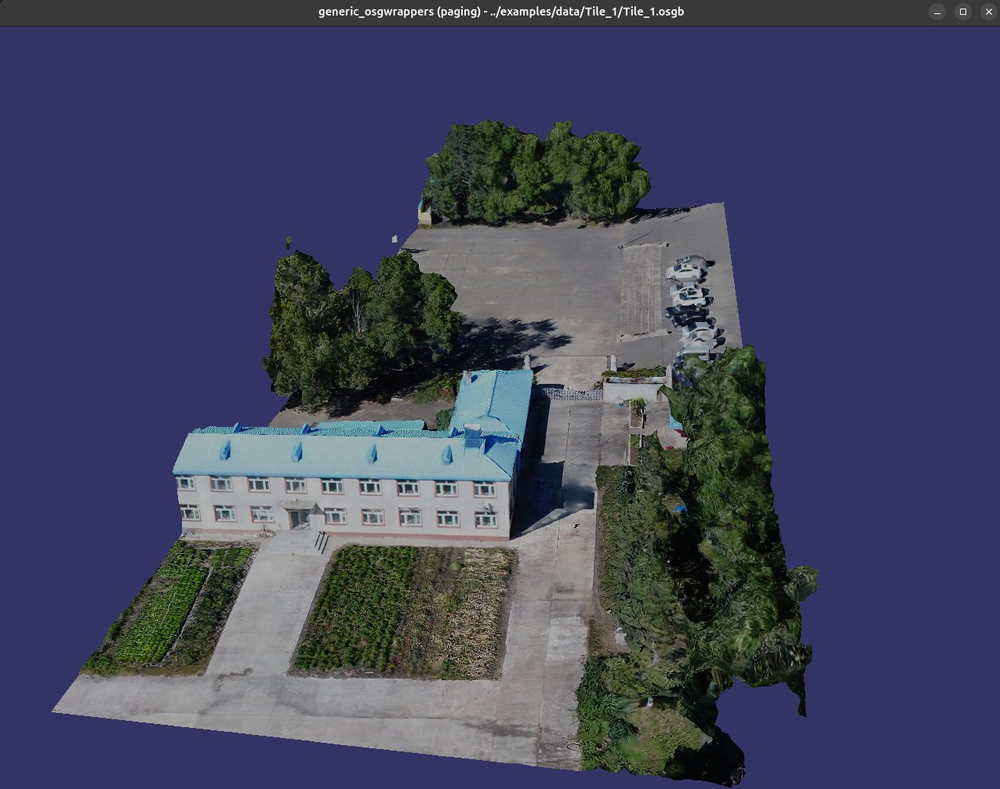
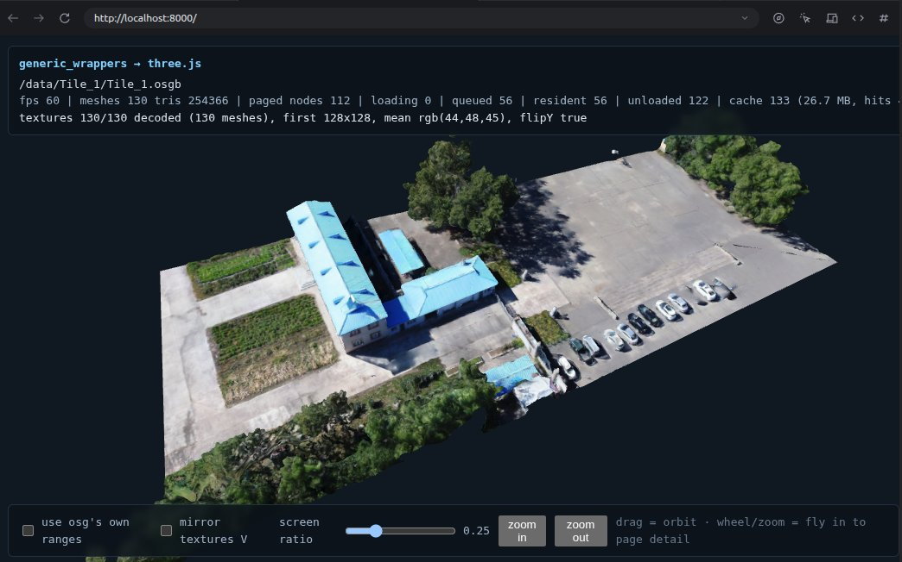
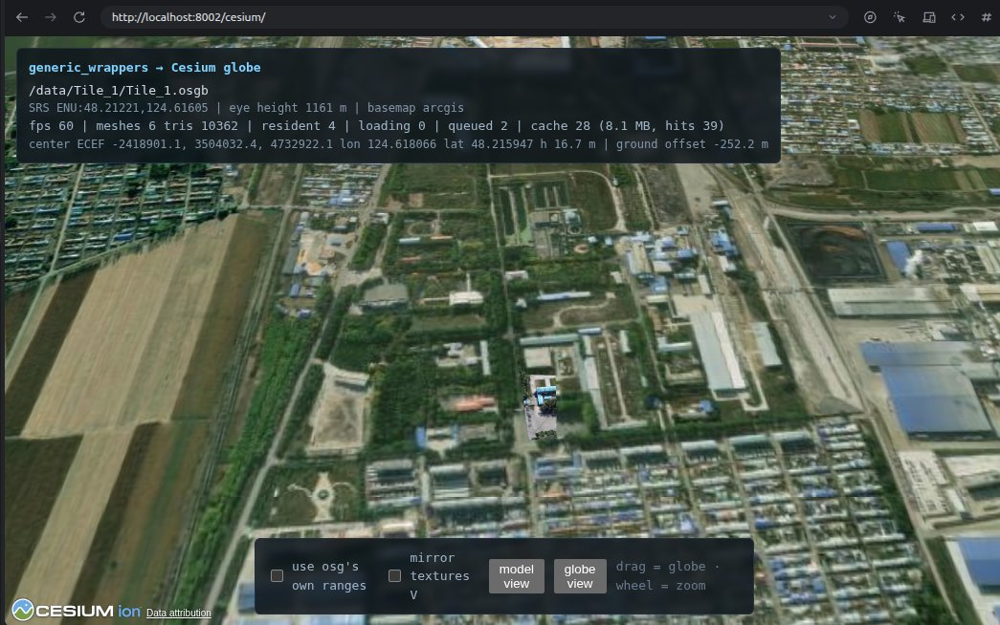

# generic_wrappers

A **zero-OSG-dependency** re-implementation of the OpenSceneGraph serialization
subsystem (the `osgDB` "wrappers"). It reads `.osgt` (ASCII) and `.osgb` (binary)
files and reconstructs the object graph **without linking against OpenSceneGraph**.

The `generic_osg/` directory contains one translation unit per OSG class, adapted
from OSG's own serializer sources so that the same read logic can be driven
standalone.

## Showcase

The same `examples/data/Tile_1/Tile_1.osgb` paged scene, read by the native VSG
example, the three.js / WebAssembly viewer, and on a Cesium globe:

| VSG (`examples/vsg`) | three.js / WebGL (`examples/threejs`) | CesiumJS globe (`examples/cesium`) |
|:---:|:---:|:---:|
|  |  |  |

---

## 1. How it works (simulating OSG serialize wrappers)

OSG stores objects through a per-class *wrapper*: `REGISTER_OBJECT_WRAPPER(name,
prototype, class, associates)` declares a list of serializable properties using
serializer macros (`ADD_INT_SERIALIZER`, `ADD_OBJECT_SERIALIZER`,
`ADD_VEC3F_SERIALIZER`, `BEGIN_ENUM_SERIALIZER`, ...). When loading, OSG uses the
class name read from the stream to find the wrapper and then reads properties in
the declared order.

This project re-implements that mechanism standalone:

* **Registry** — `Rewrapper` / `RewrapperManager` (in `GenericReserializer.h`)
  hold, per class name, an ordered list of `(propertyName, BaseSerializer)` pairs,
  mirroring the OSG wrapper layout.
* **Serializer kinds** — `ValueSerializer<T>`, `BoolSerializer`,
  `StringSerializer`, `ObjectSerializer`, `ImageSerializer`, `VectorSerializer`,
  `ListSerializer`, `EnumSerializer`, `BitFlagSerializer`, `GLenumSerializer`, and
  `UserSerializer` (a custom read callback). Each knows how to pull its value off
  the stream.
* **Registration** — the `REGISTER_OBJECT_WRAPPER` macro expands into a static
  `RegisterWrapperProxy` that registers the wrapper into `RewrapperManager`
  **before `main()` runs**. Because those registrars are never referenced
  explicitly, the archive is linked with *whole-archive*
  (`--whole-archive` / `/WHOLEARCHIVE`) by default; with
  `-DENABLE_STATIC_LIBRARY=ON` the executable instead keeps them alive by
  explicitly activating each library through `GenericStaticWrappers.h`
  (see §3).
* **Dispatch** — `SerializerVisitor` walks a wrapper and routes every serializer
  to its read path (`readSerializerValue`), keeping the reader generic.
* **Math / base layer** — `GenericMath.h` defines a minimal stub set
  (`Referenced`/`ref_ptr`, `Vec<N,T>` and the `Vec2*/Vec3*/Vec4*` families,
  `Quat`, `Plane`, `Matrix`, `BoundingBox*`, `BoundingSphere*`, GL typedefs) so
  the adapted `generic_osg/*.cpp` sources compile with no `libosg`.
  The stubs live in `GENERIC_OSG_NAMESPACE` (default `generic_wrappers_osg`), and
  a namespace alias keeps the `osg::` spelling used by the adapted sources. This
  is deliberate: if the stubs were emitted as `osg::Matrix`, `osg::Referenced`,
  ..., linking this library together with the real OpenSceneGraph (typically with
  static osg libraries on Windows) fails with duplicate/LNK2005 "already
  defined" errors, because both sides define the same mangled names with
  different layouts. Override `GENERIC_OSG_NAMESPACE` to pick another name.
* **I/O layer** — `GenericInputStream.h/.cpp` provide `InputIterator`
  (`BinaryInputIterator` / `AsciiInputIterator`) and `InputStream`. The format is
  detected from the first 8 header bytes; `.osgt` is parsed as text, `.osgb` is
  read as raw binary (byte order handled via `setByteSwap`).
* **Output** — reading does **not** construct real OSG objects. `readObject()`
  walks the stream and records the result into `InputUserData`: a scene tree
  (`TreeNode` = class name, id, file offset, parent/child links) plus explicit
  commands (`ud.add("setXxx", ...)` / `ud.add("addChild", ...)`) emitted by the
  user-serializer `read*` functions. Those commands are forwarded to the optional
  `SerializerVisitor` and/or recorded into a neutral `SceneIR` (see `SceneIR.h`)
  that a host adapter can replay to rebuild the graph in another engine.

Entry point (`GenericReader.h`):

```cpp
osgVerse::loadRewrappers();
osgVerse::InputUserData ud;
osgVerse::ObjectTypeAndID oid = osgVerse::readObjectFile("model.osgb", ud);
// oid._type is the top-level class name, e.g. "osg::MatrixTransform"
```

### Current format support

* `.osgb` — **uncompressed** binary and `.osgt` — ASCII text.
* zlib-compressed `.osgb` streams are **not** supported yet
  (`InputStream::decompress()` rejects any compressor other than `"0"`).

---

## 2. Why dependency-free `.osgb` reading matters

`.osgb` is OSG's compact, widely used runtime format, but consuming it normally
means building and linking the full OpenSceneGraph library — a large, platform-
and toolchain-sensitive C++ dependency with ABI constraints.

Reading `.osgb` without OSG makes it possible to:

* **Inspect and validate** assets (structure, versions, class usage) on any
  machine, in CI, or in offline tooling.
* **Convert / migrate** OSG assets into other renderers and engines without an
  OSG build step.
* **Ship a lightweight decoder** into environments where `libosg` cannot be used:
  browsers/WASM, mobile, embedded, sandboxes, and server-side pipelines.
* **Own the format layer** — custom memory handling, streaming, and re-serialization
  strategies are under direct control instead of being tied to OSG internals.

The whole library depends only on the C++17 standard library.

---

## 3. Build

Requirements: a C++17 compiler and CMake >= 3.10. No third-party libraries.

```bash
cmake -S . -B build
cmake --build build
```

This produces the dependency-free static library `osgVerseGenericReserializer`
and two executables that depend only on it:

* `reserializing_test` — parses a file and prints the object scene tree.
* `null_integration` — rebuilds the neutral `SceneIR` and prints everything the
  IR describes (object/command histograms, data payloads, full scene tree).

Run them on any `.osgt` / `.osgb` file:

```bash
./build/reserializing_test <file.osgt|file.osgb> [--force-ascii]
./build/null_integration  <file.osgt|file.osgb>
```

Output of `reserializing_test` reports the number of registered rewrappers, the
top-level object class, and the parsed scene tree:

```
Rewrappers: 461
Top object  : osg::MatrixTransform (id=1)
Scene tree  : 519 objects read
- osg::MatrixTransform (id=1, @0x19)
  ...
Done.
```

`--force-ascii` skips binary detection and parses the input as ASCII text.

### Static library (`ENABLE_STATIC_LIBRARY`)

By default the core archive is linked with *whole-archive* so the static
registrars survive. `-DENABLE_STATIC_LIBRARY=ON` replaces that with an explicit,
plain static link: nothing is force-included, and each executable keeps the
registrars alive by including `GenericStaticWrappers.h` — guarded by the
`OSGVERSE_GENERIC_USE_STATIC_ACTIVATION` define the option adds to it:

```bash
cmake -S . -B build-static -DENABLE_STATIC_LIBRARY=ON
cmake --build build-static
```

`GenericStaticWrappers.h` mirrors osgDB's `USE_SERIALIZER_WRAPPER_LIBRARY`: it
references one `wrapper_serializer_library_<lib>()` anchor per ported library
(defined in each `generic_osg*/LibraryWrapper.cpp`), which is what makes the
linker keep those members and, transitively, every per-class registrar. Both
modes register the same **461** wrappers — `reserializing_test` prints the count
(`Rewrappers: 461`) and both produce byte-identical `null_integration` output.

### WebAssembly (Emscripten)

The core and the dependency-free executables (`reserializing_test`,
`null_integration`) build to WASM unchanged, since they use only the standard
library. With Emscripten installed (this tree uses `~/Public/emsdk`):

```bash
source ~/Public/emsdk/emsdk_env.sh
emcmake cmake -S . -B build-wasm -DENABLE_STATIC_LIBRARY=ON \
    -DCMAKE_BUILD_TYPE=Release -DCMAKE_EXE_LINKER_FLAGS="-sNODERAWFS=1 -sEXIT_RUNTIME=1"
cmake --build build-wasm
```

This emits `build-wasm/reserializing_test.js` + `.wasm` and
`null_integration.js` + `.wasm`. Run them under node — `-sNODERAWFS=1` lets the
module read files from the host filesystem and `-sEXIT_RUNTIME=1` makes the
process exit after `main()`:

```bash
node build-wasm/reserializing_test.js ~/Public/Assets/osg-data/cessna.osgt
node build-wasm/null_integration.js  ~/Public/Assets/osg-data/clock.osgt
```

`ENABLE_STATIC_LIBRARY=ON` is recommended for WASM (the explicit activation
avoids depending on whole-archive); the default whole-archive path also links
under Emscripten. `-sNODERAWFS=1` is only needed to read host files under node —
in a browser, mount the asset (or embed it with `--preload-file`) instead.

### Engine examples

Concrete engine adapters live in `examples/<engine>/`; each one pulls in its own
engine SDK and is disabled by default. All of them read the same neutral
`SceneIR`, so they share one implementation strategy (create engine objects, then
replay the recorded commands).

| Directory | Engine | Enabled with |
|---|---|---|
| `examples/null/` | none — prints what the IR contains | always built |
| `examples/vsg/` | VulkanSceneGraph | `-DENABLE_VSG=ON -DVSG_ROOT=<sdk>` |
| `examples/threejs/` | three.js / WebGL | Emscripten build, no option |
| `examples/cesium/` | CesiumJS globe + three.js overlay | CDN Cesium build, no option |
| `examples/opengl/` | plain OpenGL 3.3 core | `-DENABLE_OPENGL=ON` |

Sample data lives in `examples/data/` (a paged `.osgb` database plus the
`metadata.xml` that georeferences it).

**VulkanSceneGraph (VSG)** — rebuilds the IR into VSG's default scene graph
(`vsg::Group` / `vsg::MatrixTransform` / `vsg::LOD` / `vsg::Switch`, with
`vsg::VertexIndexDraw` / `vsg::VertexDraw` and a Phong graphics pipeline built
per geometry) and renders it with `vsg::Viewer`. Textures are loaded through
`vsgXchange` (SGI `.rgb` textures, which `vsgXchange` has no reader for, are
decoded locally), and the camera is framed from the computed scene bounds:

```bash
cmake -S . -B build -DENABLE_VSG=ON -DVSG_ROOT=/path/to/vsg-sdk  # include/ + lib/cmake/
cmake --build build
./build/vsg_integration <file.osgt|file.osgb>          # render
./build/vsg_integration <file.osgt|file.osgb> --list   # rebuild + report only
```

The adapter itself lives in `examples/vsg/vsg_scene_builder.h`, so it can also be
registered as a `vsg::ReaderWriter`. `vsg_plugin_integration` does exactly that,
which turns `osg::PagedLOD` / `osg::ProxyNode` into `vsg::PagedLOD` and lets VSG's
own `DatabasePager` stream the child `.osgb` files through the generic reader:

```bash
./build/vsg_plugin_integration <root.osgb> --list              # report only
./build/vsg_plugin_integration <root.osgb> --load-levels 2     # preload 2 levels
./build/vsg_plugin_integration <root.osgb> --lod-ratio 0.25    # pager switch ratio
./build/vsg_plugin_integration <root.osgb> -f 300              # run 300 frames
```

Images embedded inside an `.osgb` (osg's "inline file" storage) are decoded from
memory through `vsgXchange`, so databases that carry their JPEG/PNG textures
inside the tile files render without any texture files on disk. See §4 for how
the two VSG examples differ.

**OpenGL 3.3 core** — a small desktop example with no engine SDK: the same
SceneIR is replayed into VAOs/VBOs and drawn with FreeGLUT + GLEW. Embedded
JPEG/PNG textures are decoded by the vendored `stb_image.h` in
`examples/opengl/third_party/`, so there is no libjpeg/libpng dependency.
`PagedLOD` children are loaded synchronously up to `--load-levels N` (0 keeps
only the in-memory fallback), which is enough to inspect a real paged database:

```bash
cmake -S . -B build -DENABLE_OPENGL=ON
cmake --build build --target opengl_integration
./build/opengl_integration examples/data/Tile_1/Tile_1.osgb --load-levels 2
./build/opengl_integration examples/data/Tile_1/Tile_1.osgb --list
./build/opengl_integration examples/data/Tile_1/Tile_1.osgb --screenshot shot.ppm
```

Drag = orbit, wheel = zoom, `R` = reset, `Esc` = quit. `--screenshot` writes a
PPM after the first frame, which is handy on headless machines. On Windows,
FreeGLUT and GLEW are the only external packages (for example through vcpkg);
the image decoder is compiled in.

**three.js / WebGL** — the reader is compiled to WebAssembly (embind) and the
scene is rebuilt in JavaScript. Because the browser has no `DatabasePager`, the
example ships a deliberately small one: each frame it walks the `vsg`-style
paged nodes, tests their bounding sphere against the camera frustum and its
screen-height ratio, and fetches + merges the next level only when the tile is
both visible and big enough. See §4 for details.

```bash
source ~/Public/emsdk/emsdk_env.sh                     # or any Emscripten SDK
emcmake cmake -S . -B build-wasm -DENABLE_STATIC_LIBRARY=ON -DCMAKE_BUILD_TYPE=Release
cmake --build build-wasm --target generic_osg_wasm     # -> examples/threejs/dist/*
python3 examples/threejs/serve.py                      # http://localhost:8000/
```

The page loads `/data/Tile_1/Tile_1.osgb` by default; pass `?model=/data/<file>`
to open another file, and `serve.py --data <dir>` to serve a different dataset
directory under `/data/`.

**CesiumJS** — the model is placed on a Cesium globe. Cesium's own dynamic
scheduler only understands 3D Tiles, glTF models and terrain; an
`osg::PagedLOD` tree is none of those, so the JS `DatabasePager` from the
three.js example is reused unchanged. Cesium supplies the globe, the
georeferenced camera and the input handling, while the OSGB tiles are drawn by
the same three.js adapter on a transparent canvas above it. `metadata.xml`
(`ENU:latitude,longitude`) provides the local frame; see §4 for the coordinate
handling.

```bash
python3 examples/cesium/serve.py        # http://localhost:8002/cesium/
# ?model=/data/<file>&metadata=/data/metadata.xml&imagery=arcgis|osm|none
# ?up=<origin height in metres>
```

The basemap is Esri World Imagery (`arcgis`, fetched from
`services.arcgisonline.com`, no token required). `imagery=osm` uses
OpenStreetMap tiles and `imagery=none` keeps the flat globe colour.
`model view` / `globe view` snap the camera between the dataset and a ~8 km
overview.

CesiumJS 1.121.0 is loaded from jsDelivr
(`cdn.jsdelivr.net/npm/cesium@1.121.0/Build/Cesium/`), so the example is
online-only: both the library and the basemap come from the network. No terrain
is configured: the model is shifted down so its ground surface sits on the
ellipsoid (see §4), and `up=` offsets that base elevation.

### Directory layout

```
.                       dependency-free core (reader, IR, math layer)
generic_osg/            one wrapper per osg core class
generic_osgterrain/     osgTerrain      generic_osganimation/  osgAnimation
generic_osgparticle/    osgParticle     generic_osgvolume/     osgVolume
generic_osgsim/         osgSim          generic_osgmanipulator/ osgManipulator
generic_osgshadow/      osgShadow       generic_osgui/         osgUI
generic_osgga/          osgGA           generic_osgfx/         osgFX
generic_osgviewer/      osgViewer       generic_osgtext/       osgText
generic_osgutil/        osgUtil
examples/null/          null_integration (zero-dependency IR dump)
examples/vsg/           vsg_integration / vsg_plugin_integration
examples/threejs/       WebGL example: wrappers_wasm.cpp, js/, serve.py
examples/cesium/        CesiumJS globe + the same three.js adapter/pager
examples/opengl/        plain OpenGL 3.3 core: FreeGLUT/GLEW + vendored stb_image
examples/data/          sample .osgb database + metadata.xml (paging test data)
```

Every osg library shipped with OpenSceneGraph has been ported this way: create
`generic_osg<lib>/`, take the wrappers from
`OpenSceneGraph/src/osgWrappers/serializers/osg<lib>/`, include
`GenericReserializer.h`, turn the `read*` functions into the
`ud.add("setXxx", ...)` form, drop the `check*`/`write*` helpers, then add the
directory to the library sources in `CMakeLists.txt`.

---

## 4. Embedding and rendering in 3D engines

An engine adapter is a single class implementing `ISceneBuilder` (`SceneIR.h`):

```cpp
struct ISceneBuilder
{
    virtual void onObject (const IRObject&, int index) = 0;                    // create the engine object
    virtual void onCommand(const IRObject&, int index, const IRCommand&) = 0;  // apply one property / command
    virtual void finish() {}
};
```

`buildScene(ir, builder)` replays the recorded read order into it. An adapter never
sees the file format — only object class names, typed arguments and object
references — so supporting a new engine means writing one of these classes.

`examples/` currently contains:

* **Null** — `null/null_integration.cpp`: zero-dependency, prints what the IR
  contains (class/command histograms, scene tree, data payload summaries).
* **VulkanSceneGraph** — the adapter lives in `vsg/vsg_scene_builder.h` and is
  shared by two front ends: `vsg_integration.cpp` and
  `vsg_plugin_integration.cpp`.
* **three.js / WebGL** — `threejs/`: the reader is built to WebAssembly and the
  adapter is `threejs/js/sceneBuilder.js`; `threejs/js/databasePager.js` is a
  minimal paging implementation (see below).

### VSG: `vsg_integration` vs `vsg_plugin_integration`

Both front ends use the same adapter (`examples/vsg_scene_builder.h` — geometry,
material, texture, `vsg::LOD` and `vsg::PagedLOD` conversion), so they produce the
same scene graph and the same image. The difference is **how the file is reached**:

* `vsg_integration` reads the file itself: `readSceneIR()` → `VsgSceneBuilder` →
  `buildScene()`, and hands the result straight to `vsg::Viewer`. VSG's IO layer is
  never involved, so `vsg::read()` has no reader for `.osgb`/`.osgt`. A
  `PagedLOD`/`ProxyNode` is still rebuilt as a `vsg::PagedLOD`, but VSG's
  `DatabasePager` cannot resolve the child format and logs
  `Failed to read ... Tile_1_L15_0.osgb`.
* `vsg_plugin_integration` wraps that same adapter in a `vsg::ReaderWriter`
  (`OsgbReaderWriter`) and adds it to `vsg::Options`, then loads the root through
  `vsg::read()`. Because VSG's own IO can resolve the format now, its
  `DatabasePager` streams the children in on demand:

  ```
  osg::PagedLOD / osg::ProxyNode
      -> vsg::PagedLOD{ filename = child .osgb, children[1] = in-memory fallback, options = ... }
      -> DatabasePager: vsg::read(filename, plod->options)
      -> OsgbReaderWriter::read() -> readSceneIR() -> VsgSceneBuilder
      -> merged back in as children[0]
  ```

| Aspect | `vsg_integration` | `vsg_plugin_integration` |
|---|---|---|
| Reads via | `readSceneIR()` directly | `vsg::read()` through the registered `vsg::ReaderWriter` |
| PagedLOD / ProxyNode | node is built, but the pager cannot load the child format | children are streamed in by VSG's `DatabasePager`, or synchronously with `--load-levels N` |
| Extra options | — | `--load-levels N`, `--lod-ratio R`, `--max-paged-lod N`, `-f/--frames` |
| Reports | IR objects/events, rebuilt objects, draws, paged LODs, missing images, unhandled properties | root, paged LODs, the child `FileName` list discovered per file, preloaded count |
| Render graph | `createRenderGraphForView` + explicit `CommandGraph` | `createCommandGraphForView` + `ResourceHints` on the root (pre-sizes Vulkan resources for the paged database) |

`--list` on a paged database shows the child `FileName` list that each
`osg::PagedLOD` / `osg::ProxyNode` exposed (see §3 for the build/run commands):

```
$ vsg_plugin_integration Tile_1.osgb --list --load-levels 4
Root        : vsg::PagedLOD
PagedLODs   : 6
Paging tree (file -> child FileName list):
  Tile_1.osgb            -> Tile_1_L15_0.osgb
  Tile_1_L15_0.osgb      -> Tile_1_L16_00.osgb
  Tile_1_L16_00.osgb     -> Tile_1_L17_000.osgb
  Tile_1_L17_000.osgb    -> Tile_1_L18_0000t3.osgb
  Tile_1_L18_0000t3.osgb -> Tile_1_L19_00000t3.osgb Tile_1_L19_00010t3.osgb
```

Adapter notes / current gaps (the full list of osg classes that are *not*
converted, with the reason for each, is in the header comment of
`examples/vsg_scene_builder.h`):

* `osg::Program`/`Shader`/`Uniform` (custom GLSL), `osg::TexGen`,
  `TexEnv`/`TexEnvCombine`, scene-graph lights, clip planes, cube maps and
  `osg::ShapeDrawable` are not translated, so those assets keep the default Phong
  look (or draw nothing, for parametric shapes).
* Textures follow osg's row layout: osg stores image rows bottom-up
  (`osg::Image`'s default `BOTTOM_LEFT`, and its jpeg/png plugins flip the file
  rows on load), while `vsgXchange` returns top-down rows. Decoded images are
  flipped back (`toOsgRowOrder()`) so osg's texture coordinates land on the same
  texels instead of every texture coming out mirrored.
* `osg::TexGen` (e.g. `SPHERE_MAP`), cube maps and custom `Shader`/`Program`
  assets are not converted yet, so those few assets (cow's environment map,
  `cube_mapped_torus`, the `glsl_*` samples) render without their special effect.
* The Phong pipeline is created per geometry, so the first pass ignores `StateSet`
  inheritance and per-geometry state overrides.

### three.js: the JavaScript pager

`examples/threejs/` splits the work the same way the other adapters do, only the
engine side is JavaScript:

```
fetch(.osgb)  ->  generic_osg_wasm.js (embind)  ->  SceneIR (plain JS object)
              ->  js/sceneBuilder.js             ->  three.js scene graph
              ->  js/databasePager.js            ->  streams the next LOD level
```

`wrappers_wasm.cpp` reuses the very same reader (`readSceneIR(std::istream&)`
reads from the fetched bytes, since a browser has no filesystem) and hands the IR
over as plain JS objects with typed arrays, so the adapter stays in JavaScript.

`js/databasePager.js` deliberately does **not** reproduce osgDB's threaded
load-and-merge machinery. Every frame it asks two questions per paged node:

1. is its bounding sphere inside the camera frustum, and
2. does it cover enough of the screen height
   (`radius / distance / tan(fovY/2)`), where the threshold comes from osg's own
   `setRange` max (`1 / (maxRange * tan(fovY/2))`) or from the UI slider?

If both hold, the child file is fetched, read through the same WASM reader,
converted with the same `sceneBuilder.js`, attached to the node, and the in-memory
stand-in (osg's `children[1]`) is hidden. PagedLOD nodes found inside the loaded
file are registered the same way, so paging continues down the tree. Loads are
limited to a few in flight per frame.

Tiles are also unloaded again: a resident tile that stays outside the frustum or
below half of its load threshold for `expiryDelay` seconds is detached, its
geometry/materials/textures are disposed and the node becomes loadable again (the
in-memory stand-in is shown meanwhile). Fetched file bytes are kept in an LRU
cache with a byte budget (`cacheLimit`, 64 MB by default), so revisiting a tile
re-parses locally instead of hitting the network; the HUD reports resident /
unloaded counts and cache usage.

Adapter notes (same gaps as the VSG adapter, plus browser specifics):

* Textures embedded in the `.osgb` are handed to the browser decoder as a `Blob`.
  Note that `Texture.flipY` is **ignored for `ImageBitmap` sources**, so the osg
  row order (`v = 0` at the bottom of the picture) has to be baked in at decode
  time with `createImageBitmap(blob, { imageOrientation: 'flipY' })`; setting
  `flipY` alone leaves every texture mirrored and makes the mesh sample the photo's
  black padding. `mirror textures V` re-decodes them the other way, and a 1×1 white
  placeholder keeps a missing texture from rendering black while it loads.
* A geometry without a normal array is drawn with an unlit material
  (`MeshBasicMaterial`): photogrammetry bakes its lighting into the texture, and
  deriving normals instead yields `NaN` for degenerate triangles and black patches.
  Only geometries that do carry normals get a Phong material.
* All images of a file are decoded before its graph is built, so a tile appears
  already textured instead of flashing white and swapping its texture in later.
* External texture names are resolved relative to the file that references them
  (`Images/clockface.JPG` next to the model), and a node's bounding sphere
  (`PagedLOD::setCenter/setRadius`, or an explicit `InitialBound`) is used to
  frame the camera — osg scenes are rarely centred on the origin.
* osg assets are Z-up; the model is rotated into three's Y-up world, and the key
  light is placed accordingly (otherwise terrain is lit from underneath and comes
  out almost black). Photogrammetry tiles already carry their baked lighting, so
  the ambient term dominates.

### OpenGL core: a dependency-light adapter

`examples/opengl/gl_scene_builder.cpp` implements the same `ISceneBuilder`
interface as the VSG and three.js adapters, so it only translates IR commands:

* object classification into group / transform / geometry / LOD / PagedLOD nodes,
  plus the array, primitive, image, state-set, texture and material records;
* `addChild`, `Matrix`, geometry array and state-set commands, and the
  `setFileName` / `setRange` / `setCenter` / `setRadius` set used by LODs;
* primitive sets are expanded to plain triangle/line/point lists (strips, fans,
  quads and line loops are decomposed), because a geometry may mix topologies;
* positions, normals, colours and texture coordinates are interleaved into one
  VBO, with one VAO/EBO per expanded topology. Geometries without normals are
  drawn unlit, matching the three.js adapter; culling is disabled because
  photogrammetry winding is not always consistent.

Textures are decoded by the vendored `stb_image.h` (`image_decode.cpp` compiles
the implementation once): embedded "inline file" images and external files are
both supported, rows are flipped to osg's bottom-up order, and the result is
uploaded as `GL_RGBA8` with mipmaps. `--load-levels N` walks the PagedLOD child
files synchronously at load time (recursively, with paths resolved relative to
the parent tile); when a child file is resident the in-memory fallback is no
longer drawn. There is no background pager or unloading in this example.

### Cesium: georeferencing the OSGB overlay

`examples/cesium/` reads `examples/data/metadata.xml`:

```xml
<SRS>ENU:48.21221,124.61605</SRS>   <!-- latitude, longitude -->
<SRSOrigin>0,0,0</SRSOrigin>
```

`Transforms.eastNorthUpToFixedFrame` turns that into the ENU-to-ECEF matrix
(`SRSOrigin` is applied as a translation in the same frame). The important
design choice is that the **three.js world is that ENU frame** (X east, Y north,
Z up), so the tile geometry needs no per-vertex conversion and no rotation:

* The initial Cesium view converts the model's bounding-sphere centre to ECEF
  once, to place `Camera.flyToBoundingSphere`.
* Every frame the Cesium camera is converted the other way — `positionWC`,
  `directionWC` and `upWC` through the ECEF-to-ENU inverse matrix — and becomes
  the three.js camera (`right = direction × up`, `fovy` → `fov`, near/far
  clipped). The globe camera therefore also drives the pager, exactly as in the
  three.js example.
* Keeping the world local means the GPU only ever sees coordinates of a few
  hundred metres, not the ~6.3e6 m ECEF values that would lose precision in
  float32 shaders.
* The file's z values put this site ~266 m above the ellipsoid, and the lowest
  vertex belongs to a few degenerate triangles ~13 m below the real surface.
  The ground height is therefore estimated from the triangle-area distribution
  (5% area quantile of triangle-centroid z) and the whole model is shifted down
  by that amount; the main terrain then sits within ~0.3 m of the ellipsoid.
* `?up=<metres>` offsets the ENU origin ellipsoidally when the metadata carries
  no vertical datum.

Limitations: only `ENU:lat,lon` metadata is understood (an `EPSG:` SRS needs a
proper projection/geoid step). Because Cesium and three.js each have their own
depth buffer, the globe cannot occlude the overlaid tiles; with the default
ellipsoid globe this is not visible, but a real-terrain setup would need a
depth-aware composite.

Planned / to be filled in:

* Babylon.js —
* Godot —
* Unity —
* Unreal Engine —
